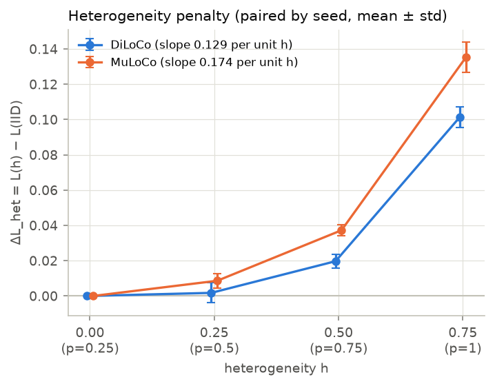

# Muon Workers Drift Further: Data Heterogeneity in Low-Communication Training with Muon

Abhay Paidipalli, Ethan Liu, Logan Wall, Prabhnoor Rai (equal contribution). UC Berkeley, EECS 182 final project, Fall 2026.

**Paper:** [`report/main.tex`](report/main.tex) (NeurIPS 2026 style). **Checkpoints:** [Hugging Face](https://huggingface.co/paidvenk/muloco-data-heterogeneity).

DiLoCo trains a language model on several workers that take many local optimizer steps between synchronizations;
MuLoCo replaces DiLoCo's inner AdamW with Muon and improves on it, but both were studied only with workers that see
the same data. We ask whether MuLoCo keeps its advantage when each worker trains mostly on a different text domain,
and whether DiLoCo's outer Nesterov momentum protects it from client drift.

## Findings

We pretrain 51M-parameter GPT models from scratch with four workers on four domains (ArXiv, GitHub, StackExchange,
Wikipedia), varying a deterministic skew from IID (p = 0.25) to one domain per worker (p = 1) while keeping the
global data mixture fixed. Three seeds per condition, 42 production runs.

- **MuLoCo keeps the lower loss at every skew level, but pays a larger heterogeneity penalty.** At full skew its
  penalty is 0.135 ± 0.009 nats vs. DiLoCo's 0.101 ± 0.006 (difference +0.034, same sign on every seed), and its
  lead over DiLoCo shrinks from 0.105 to 0.071 nats.
- **Outer Nesterov momentum does not protect Muon.** It slightly reduces AdamW's penalty and does not reduce Muon's;
  plain averaging (FedAvg-Muon) and MuLoCo end up tied at full skew.
- **Parameter-space drift diagnostics point the wrong way; function-space drift does not.** MuLoCo's pseudo-gradients
  look better aligned, yet its workers specialize about 1.7× more toward their home domain within each round.

<p align="center"></p>

## Repository layout

```
src/                 training code (model, data, partition, optimizers, diagnostics, train loop)
  train.py           single entry point for every run (DP baselines and the DiLoCo family)
  prepare_data.py    download + tokenize the four domains (pinned revisions, content hash)
configs/frozen.yaml  the tuned hyperparameters used by every production run
manifests/           one line of CLI arguments per run: tuning stages and the production grid
runs/<run_id>/       logs of all 74 runs: config.json, metrics.jsonl, summary.json
analysis/plots.py    every figure and table in the paper, from runs/
figures/             generated figures (PNG + PDF) and summary.md with the result tables
report/              paper source (main.tex, refs.bib, neurips_2026.sty)
scripts/             manifest generation and run download/backup
modal_app.py         launch runs on Modal cloud GPUs (modal_prepare.py builds the data volume)
tests/               correctness tests (CPU, ~10 s)
CHECKPOINTS.sha256   SHA-256 of all 49 checkpoints on Hugging Face
```

Run IDs encode the configuration, e.g. `muloco_p1.00_H30_s2` (method, skew p, sync interval H, seed). Tuning runs
carry a suffix tag (`_lr…`/`_lrm…` for Stage A, `_eo…_mu…` for Stage B, `_innerx…` for Stage C, `_pilot`); the production runs are the untagged ones plus the two
Stage A runs that double as the seed-0 DP baselines (`dp_adamw_s0_lr0.0015`, `dp_muon_s0_lrm0.012`).

## Reproducing the figures and tables (no GPU needed)

All run logs are in `runs/`, so every figure and table in the paper can be regenerated on a laptop:

```bash
git clone https://github.com/abhay1105/muloco-data-heterogeneity.git
cd muloco-data-heterogeneity
uv venv --python 3.12 .venv && uv pip install --python .venv/bin/python -r requirements.txt
.venv/bin/python analysis/plots.py     # writes figures/*.png, figures/*.pdf and figures/summary.md
```

To compile the paper, upload `report/` and `figures/` to Overleaf (or run
`pdflatex main && bibtex main && pdflatex main && pdflatex main` inside `report/`).

## Checkpoints

The final model of every full-length run (`final.pt`, bf16 state dict, ~102 MB) is on
[Hugging Face](https://huggingface.co/paidvenk/muloco-data-heterogeneity) under the same `runs/<run_id>/` paths,
with a second copy of every log. `CHECKPOINTS.sha256` lists their hashes. To load one:

```python
import json, torch
from src.model import GPT
cfg = json.load(open("runs/<run_id>/config.json"))
model = GPT(cfg["vocab_size"], cfg["n_layer"], cfg["n_embd"], cfg["n_head"], cfg["seq_len"])
model.load_state_dict({k: v.float() for k, v in torch.load("runs/<run_id>/final.pt").items()})
```

## Re-running the experiments

Each full-length run takes about 20–30 minutes on one A100-80GB; the whole project (tuning plus 42 production runs)
used about 24 GPU-hours. We ran everything on [Modal](https://modal.com), but `src/train.py` runs on any CUDA GPU.

**1. Data.** Builds the tokenized dataset from pinned Hugging Face revisions. It must report
`data_hash = 33c0c658fbf49a8a`.

```bash
.venv/bin/modal setup                          # one-time login
.venv/bin/modal run modal_prepare.py           # on Modal (CPU only)
# or locally:  .venv/bin/python -m src.prepare_data --out data_bin
```

**2. Runs.** Every run is one line of a manifest. Launching skips runs that already have a `summary.json`, so
re-launching a manifest is also how failed runs are retried.

```bash
.venv/bin/modal run --detach modal_app.py::launch --manifest manifests/phase2.txt   # all 40 production runs
.venv/bin/modal run modal_app.py::status --manifest manifests/phase2.txt            # progress
.venv/bin/python scripts/sync_runs.py --no-upload                                   # download finished runs to runs/
```

Without Modal, run a manifest line directly, e.g.
`python -m src.train --config configs/frozen.yaml --method muloco --p 1.0 --seed 0 --data_dir data_bin`.

| Manifest | What it is |
|---|---|
| `pilot.txt` | throughput and end-to-end check (not used for results) |
| `stageA*.txt` | data-parallel learning-rate sweeps (full length, seed 0) |
| `stageB*.txt` | outer learning rate and momentum sweep (IID, half length) |
| `stageC*.txt` | inner learning-rate check at the chosen outer setting (IID, half length) |
| `phase2.txt` | production grid: DiLoCo/MuLoCo × 4 skews and FedAvg-AdamW/-Muon × 2 skews, 3 seeds each, plus seeds 1–2 of the DP baselines (seed 0 comes from Stage A); also split into `phase2_batch1.txt` (seed 0) and `phase2_batch2.txt` (seeds 1–2) |

A run that stops with `non-finite loss` / `diverged` is a valid outcome, not a bug (none of the production runs
diverged).

## Development

```bash
.venv/bin/python -m pytest -q                                    # 22 correctness tests
.venv/bin/python -m src.prepare_data --out data_tiny --synthetic # tiny synthetic data
.venv/bin/python -m src.train --method muloco --p 1.0 --data_dir data_tiny --n_layer 2 --n_embd 128 \
    --n_head 4 --steps 60 --H 10 --global_batch_seqs 16 --micro_batch_seqs 4 --eval_every 30 \
    --spectral_every 30 --warmup_steps 10 --compile 0             # local smoke run (CPU/MPS)
.venv/bin/python analysis/summarize.py "<run-id glob>" --diag    # quick markdown table of runs
```

## License

MIT; see [`LICENSE`](LICENSE).
